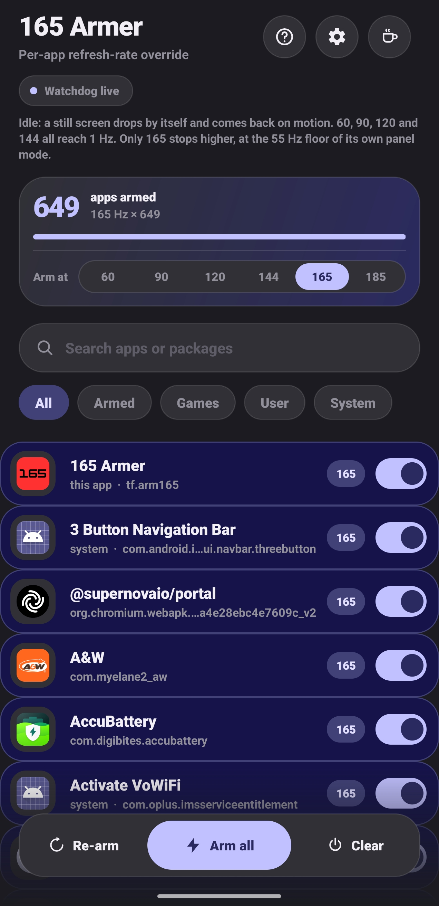
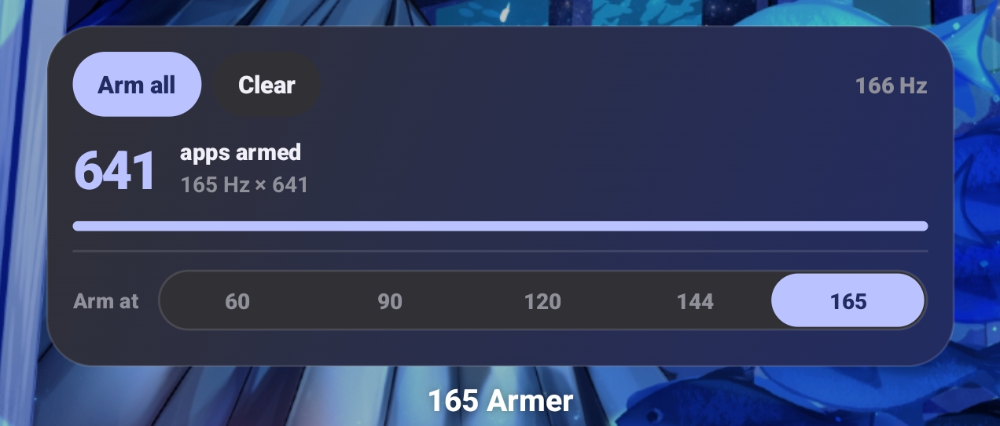

# 165 Armer

[](https://github.com/tryptz/Force165hz-Oneplus-15-NoRoot/releases/latest)
[](https://github.com/tryptz/Force165hz-Oneplus-15-NoRoot/releases)

Rootless per-app refresh-rate unlock for OnePlus phones: **60 / 90 / 120 / 144 /
165 / 185 Hz**. No root, no Magisk, no bootloader unlock.

### [Download the latest APK](https://github.com/tryptz/Force165hz-Oneplus-15-NoRoot/releases/latest/download/arm165.apk)

[Release notes and older builds](https://github.com/tryptz/Force165hz-Oneplus-15-NoRoot/releases) · [Changelog](CHANGELOG.md)

<p align="center">
  
  <br>
  
</p>

## Features

- Pin a refresh rate per app, or arm everything at once
- Search, and filters for armed, games, user and system apps
- Home-screen widget: arm all, clear and pick the rate
- Watchdog that keeps the rate held, and restores armed apps after a reboot
- Smoothness test and a live log
- English and 简体中文, with a language switcher in Settings

## How to use

1. Install the APK.
2. Pick a rate at the top.
3. Tap an app to arm it, or press **Arm all**.

Usage access is only needed when more than eight apps are armed.

## Supported phones

| Phone | Highest rate |
|---|---|
| OnePlus 16 (`PYB110`) | 185 Hz |
| OnePlus 15 (`CPH2747`, `CPH2749`, `PLK110`) | 165 Hz |
| OnePlus 15R (`CPH2767`) | 165 Hz |
| OnePlus Nord 6 (`CPH2793`) | 165 Hz |

185 Hz is offered on every phone. Where the panel tops out at 165 Hz, it
runs at 165 Hz.

Other OnePlus/OPPO phones may work if they have the `oplusscreenmode`
service. The app finds the right vendor call for each firmware at launch, and
**Settings** shows how it found it.

## Idle behaviour (LTPO)

| Selected rate | Still screen drops to |
|---|---|
| 60 / 90 / 120 Hz | ≈1 Hz |
| 144 Hz | ≈1 Hz (parks at 120 Hz while idle) |
| 165 Hz | ≈55 Hz |

Measured on the OnePlus 15. The OnePlus 15R has an LTPS panel, not LTPO, so a
still screen stays at 60 Hz or above whatever rate is selected.

## Lock screen at 120 Hz

On ColorOS, the phone's own **Screen refresh rate** option decides two things
at once. On **High**, SystemUI (app switching, the notification shade) stays at
120 Hz whatever is armed. On **Standard**, SystemUI follows the armed rate, but
the lock screen drops to 60 Hz.

**Settings → Lock screen at 120 Hz** gives you both. The phone runs on Standard
while it is unlocked and switches to High while it is locked. The switch
happens as the screen turns off and again when you unlock.

It needs one adb grant:

```sh
adb shell pm grant tf.arm165 android.permission.WRITE_SECURE_SETTINGS
```

The first time, the app asks you to set the option to Standard, then High, then
Standard again. It watches that change to learn which setting your phone
writes and its values. On the OnePlus 15 that is
`oplus_customize_screen_refresh_rate`, plus `choice_mode_rate` on Android 17.

## Notes

- Higher rates use more battery and run warmer.
- If a video app judders, arm it at 60 Hz.
- An OxygenOS update can close the interface this app uses.
- If an app stays pinned after disarming, reboot.

## How it works

The app calls OnePlus's undocumented
`IOplusScreenMode.requestGameRefreshRate(package, rateId)`. No permission is
needed. Transaction numbers differ between firmware builds, so the app
reads them from the phone at launch. Known tables are in
[`tool/tx-tables.md`](tool/tx-tables.md).

## Without the app (adb / Termux)

- [`setrate.sh`](setrate.sh) pins one app or all of them over adb:
  `setrate.sh <package> [rate]`, `--clear <package>`, `--all`.
- [`install.sh`](install.sh) sets up Termux:Boot to re-pin the apps in
  `boot/apps.txt` after every reboot.
- [`tool/`](tool) holds the helper dex, the probes, and `oplus_tx_table.py`,
  which reads the transaction table out of an OTA.

## Building

```sh
cd armer-app
./gradlew assembleRelease
```

Needs JDK 17+ and the Android SDK (platform 36). The release build comes out
unsigned. Sign it with your own key using `apksigner`.

---

**Use at your own risk.** This uses an undocumented vendor interface.
